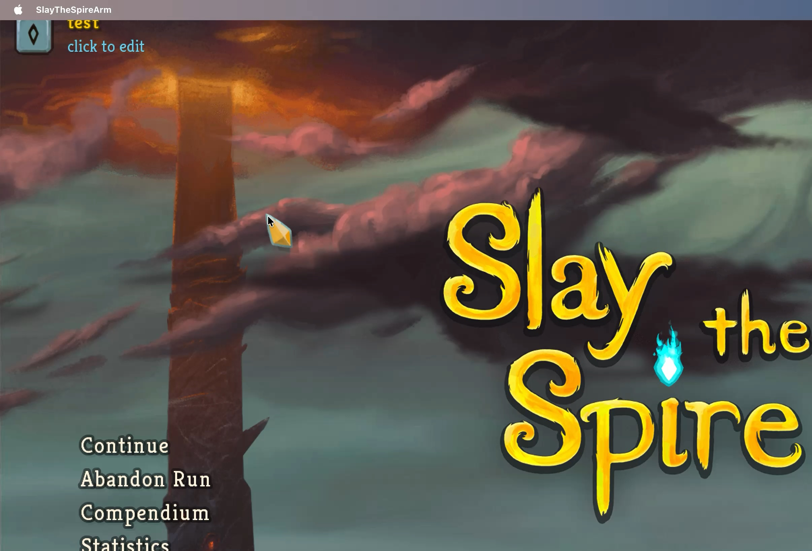
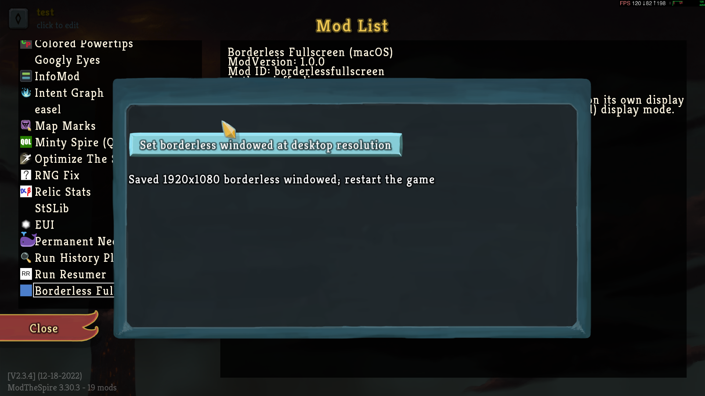

# BorderlessFullscreen Slay The Spire Mod

This is a ModTheSpire-based mod for Slay the Spire to fix borderless fullscreen behavior on Mac. Standard fullscreen on Mac works, but it takes over the entire display and does not allow for other windows to be visible on different desktops. It also blocks out all other displays if the user is using multiple displays. Borderless windowed behavior works much better, except for the fact that the menu bar is still overlaid on top of the game window, and cursor hiding behavior is inconsistent.

BorderlessFullscreen fixes this behavior, correctly hiding the menu bar whenever the game window is focused, and adding new mouse hiding behavior. Additionally, it provides a mod config button to automatically enable the correct resolution and display mode to make the mod active.

This mod is not yet released to the steam workshop.

## Installation

This mod requires ModTheSpire and BaseMod installed, which can be found in the steam workshop.

Download the newest release. Place `BorderlessFullscreen.jar` into the `Contents/Resources/mods` folder within `SlayTheSpire.app` in your steam apps directory. Check the mod checkbox when launching the game with mods, and it is active.

## Building

To build this mod yourself, you need maven. Acquire the dependencies `desktop-1.0.jar` and `BaseMod.jar` from your Slay The Spire game and from the steam workshop downloads folder, and place them into the `lib` directory. Then run `mvn package`. The mod is built into `target/BorderlessFullscreen.jar`.

## Design notes

The mod uses a similar method to Wine's borderless windowed mode for running Windows games on mac. We do this by calling `setLevel` to `NSStatusWindowLevel + 1` (26) to put the game window screen "above" the menu bar in z index. This only runs in borderless windowed mode.

Next, it messages `setCollectionBehavior` with `(1<<2) | (1<<5) | (1<<8)` like Wine does. These stand for Managed, ParticipatesInCycle, and FullScreenAuxiliary, respectively. These flags enable certain behaviors like appearing in Mission Control. This only runs in borderless windowed mode.

Finally, it checks the location of the mouse, and enforces mouse hiding if the game window is focused and the mouse position is on the game window. This runs regardless of what display mode the game is in.

These actions happen every 50ms in a loop. The first two only call AppKit to pass the message if necessary; if there are no changes, no further AppKit calls are made. The mouse hiding part runs every 50ms tick.
